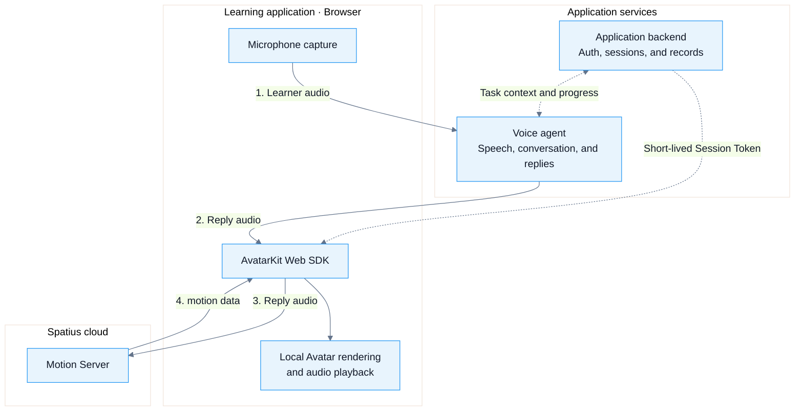
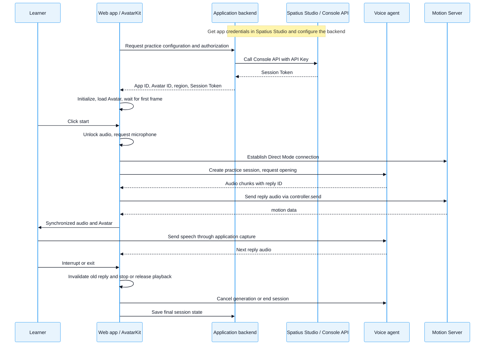

This guide explains how to integrate a real-time Avatar into a Web language learning product, from entering a practice session and playing the opening line through multiple conversation turns, interruptions, and exit.

The reference stack is **Public Avatar + AvatarKit Web SDK + Direct Mode**. Your voice agent understands the learner and generates replies; Spatius turns the reply audio into a visible Avatar performance. Connect an existing agent, or start with the voice service included in the reference project if you have not built one yet.

The implementation below uses English speaking practice as its example.

## Prerequisites

Before you start:

- Create an app in Spatius Studio, obtain its App ID and API Key, and confirm its region.
- Select an Avatar from the public library and obtain its Avatar ID.
- Prepare a voice agent that provides reply audio, or use the reference project later in this guide.
- Use the app credentials obtained in Spatius Studio to request short-lived Session Tokens through your application backend.
- Serve the Web page over HTTPS for microphone access, and give the Avatar container an explicit width and height.

This implementation sends **16 kHz, mono, signed 16-bit little-endian PCM** audio to AvatarKit.

## Architecture and sequence

### Data flow

Learner audio goes to the agent; the agent's reply audio goes to AvatarKit in the browser. In Direct Mode, AvatarKit connects to Motion Server, sends reply audio, receives motion data, and renders the Avatar locally with synchronized audio playback.

<div style={{ background: '#ffffff', borderRadius: 12, padding: 16 }}>



</div>

Solid arrows show audio and motion data flow. Dashed arrows show application configuration and authorization. Both reply audio and the Avatar are presented in the browser.

| Component | Responsibility |
| --- | --- |
| Learning application frontend | Microphone, practice interface, AvatarKit, reply audio reception, and playback control |
| Application backend | User authentication, practice sessions, Session Tokens, task context, and records |
| Voice agent | Speech understanding, conversation decisions, and reply audio generation |
| Spatius Motion Server | Convert reply audio into motion data |

Let AvatarKit play the Avatar's replies, and disable playback of the same replies in your existing agent player to prevent duplicate audio. Microphone audio is agent input; do not send it as an Avatar reply.

### Recommended practice session sequence

<div style={{ background: '#ffffff', borderRadius: 12, padding: 16 }}>



</div>

The practice endpoints, agent sessions, reply IDs, and cancellation messages in this diagram are implemented by your application, not Spatius APIs. Your backend can also relay audio between the browser and the agent without changing the AvatarKit integration boundary.

## Implementation

### 1. Return configuration and short-lived authorization from your backend

**Requirement:** A product may offer multiple tasks and characters. The frontend needs the Avatar and connection authorization for the current session without exposing the API Key.

Provide an authenticated practice preparation endpoint on your backend. It can return the following structure; adapt the endpoint name and practice fields to your application:

```json
{
  "practiceId": "practice-unique-id",
  "appId": "your-app-id",
  "avatarId": "your-avatar-id",
  "region": "us-west",
  "sessionToken": "short-lived-session-token",
  "expiresAt": 1800000000
}
```

`practiceId` associates records with a practice session. `expiresAt` illustrates an expiration timestamp returned by your application. The backend determines the App ID, Avatar ID, and region. Request the token using the API Key for the matching app.

To obtain a token, your backend calls `POST /v1/console/session-tokens` on the Console API for the selected region. Send the API Key in the `X-API-Key` header and an `expireAt` timestamp in seconds in the JSON body. The response contains `sessionToken`.

For example, this Node.js server function requests a token valid for ten minutes using the default region:

```typescript
export async function issueSessionToken(apiKey: string) {
  const expireAt = Math.floor(Date.now() / 1000) + 10 * 60;
  const response = await fetch(
    'https://console.us-west.spatius.ai/v1/console/session-tokens',
    {
      method: 'POST',
      headers: {
        'Content-Type': 'application/json',
        'X-API-Key': apiKey,
      },
      body: JSON.stringify({ expireAt }),
    },
  );
  if (!response.ok) throw new Error('Session Token issuance failed');
  const data = await response.json();
  if (typeof data.sessionToken !== 'string') {
    throw new Error('Missing Session Token');
  }
  return { sessionToken: data.sessionToken, expiresAt: expireAt };
}
```

This function shows the platform request only. Add user authentication, rate limiting, and app permission checks in your application endpoint. Use the corresponding Console API address for other regions.

**Error handling:** An expired token cannot establish a new connection. Token expiration alone does not invalidate an existing connection. Obtain valid authorization again if the learner waits before starting or needs to reconnect after a disconnect.

### 2. Load the Avatar and enable start after the first frame

**Requirement:** Learners can see the character when entering practice, but conversation must wait until the character is ready.

Install the Web SDK:

```bash
npm install @spatius/avatarkit
```

For Vite, use the official plugin to serve SDK assets. Keep any existing plugins, such as your React plugin:

```typescript
import { defineConfig } from 'vite';
import { avatarkitVitePlugin } from '@spatius/avatarkit/vite';

export default defineConfig({
  plugins: [avatarkitVitePlugin()],
});
```

The following function prepares the Avatar. Create a container with an explicit width and height first, and enable **Start practice** after the function resolves:

```typescript
import {
  AvatarSDK,
  AvatarManager,
  AvatarView,
  DrivingServiceMode,
} from '@spatius/avatarkit';

type AvatarConfig = {
  appId: string;
  avatarId: string;
  region: string;
  sessionToken: string;
};

export async function prepareAvatar(
  config: AvatarConfig,
  container: HTMLElement,
): Promise<AvatarView> {
  // Initialize at app startup, not for every reply.
  await AvatarSDK.initialize(config.appId, {
    region: config.region,
    drivingServiceMode: DrivingServiceMode.direct,
  });
  AvatarSDK.setSessionToken(config.sessionToken);
  const avatar = await AvatarManager.shared.load(config.avatarId);
  const view = new AvatarView(avatar, container, {
    audioFormat: { sampleRate: 16000, channelCount: 1 },
  });

  try {
    await new Promise<void>((resolve, reject) => {
      const timer = setTimeout(
        () => reject(new Error('Avatar first frame timed out')),
        20000,
      );
      view.onFirstRendering = () => {
        clearTimeout(timer);
        resolve();
      };
    });
    return view;
  } catch (error) {
    view.dispose();
    throw error;
  }
}
```

Downloading assets and rendering the first frame are separate stages. Do not enable conversation based only on download completion.

**Error handling:** If loading fails or the first frame times out, show the failure and a retry action rather than creating an agent session. If the learner leaves during preparation, mark that preparation as cancelled. Dispose of a view that arrives after asynchronous loading completes instead of mounting it on a page the learner has already left.

### 3. Start audio, microphone access, and the connection from a user action

**Requirement:** The browser allows audio playback, and both the Avatar and agent are ready before the opening line begins.

After the first frame, call `initializeAudioContext()` from the **Start practice** button's click handler, then establish the Avatar connection. The function below shows the SDK and browser calls for this stage and returns a microphone stream for your agent's capture module:

```typescript
import { AvatarView } from '@spatius/avatarkit';

export async function connectFromClick(view: AvatarView) {
  let microphone: MediaStream | undefined;
  try {
    // Call this function directly from the button click handler.
    await view.controller.initializeAudioContext();
    microphone = await navigator.mediaDevices.getUserMedia({
      audio: true,
    });
    await view.controller.start();
    return microphone;
  } catch (error) {
    microphone?.getTracks().forEach(track => track.stop());
    view.controller.close();
    throw error;
  }
}
```

Your application still needs to capture, encode, and send microphone audio to the agent; that work is outside this function. Disable repeated starts while connecting. Request the opening line only after the agent's input and output paths are also ready, so the opening audio does not arrive before the Avatar connects.

For example, the opening line might be “Hi! What can I get for you today?” Play it through the agent's normal reply audio path rather than a separate HTML audio player.

**Error handling:** If microphone access is denied, offer permission guidance or exit. If the Avatar connection fails, stop microphone capture. If the learner exits during startup, check cancellation after each asynchronous stage and release any resources that stage has just created.

### 4. Isolate reply audio and handle completion and interruption

**Requirement:** Learners can interrupt the Avatar. Audio from a cancelled reply must not play again even if it arrives late over the network.

Assign each reply a `replyId` that is unique within the current practice session, and include it in the reply start, audio, and end messages. Do not reuse old IDs after a retry. Your application can use this message contract:

| Application message | Contents | Client action |
| --- | --- | --- |
| `reply_start` | `practiceId`, `replyId` | Accept a new reply and clear previous playback |
| `reply_audio` | Matching reply ID and PCM audio | Send audio to AvatarKit only for the active reply |
| `reply_end` | Matching reply ID | Finalize input while allowing buffered audio to finish |
| `cancel_reply` | Reply ID to cancel | Ask the agent to stop that reply |

These names define an example application protocol, not SDK events. Preserve audio chunk order within a reply, for example by using one ordered WebSocket connection. If another source can deliver chunks out of order, reorder them before passing them to playback.

The following adapter accepts the current reply and ignores audio whose reply is no longer active or whose input has already ended:

```typescript
import type { AvatarController } from '@spatius/avatarkit';

export function createReplyBridge(controller: AvatarController) {
  let activeId: string | null = null;
  let inputEnded = false;
  let disposed = false;
  const seen = new Set<string>();

  return {
    begin(replyId: string) {
      if (disposed || seen.has(replyId)) return false;
      seen.add(replyId);
      // A new reply takes over, clearing any previous buffered playback.
      controller.interrupt();
      activeId = replyId;
      inputEnded = false;
      return true;
    },
    audio(replyId: string, pcm: ArrayBuffer) {
      if (disposed || replyId !== activeId || inputEnded) return;
      if (pcm.byteLength > 0) controller.send(pcm, false);
    },
    end(replyId: string) {
      if (disposed || replyId !== activeId || inputEnded) return;
      inputEnded = true;
      controller.send(new ArrayBuffer(0), true);
    },
    cancel() {
      const cancelledId = activeId;
      // Invalidate the old reply before stopping playback.
      activeId = null;
      inputEnded = true;
      controller.interrupt();
      return cancelledId;
    },
    dispose() {
      disposed = true;
      activeId = null;
      seen.clear();
      controller.interrupt();
    },
  };
}
```

At the protocol boundary, your application must still check that `reply_start` belongs to the current practice session and a valid request. Call `begin()` only for a request that remains valid. A late start message from a cancelled request must not reactivate playback. The adapter's `seen` set prevents ID reuse; it does not replace request validation.

**Normal completion:** `send(..., true)` finalizes input for the current reply. Do not immediately close the connection, which could cut off buffered audio that has not played yet.

**Interruption:** Call `cancel()` first, then cancel agent generation through your application protocol. Even if the cancellation request fails, the client already rejects audio from the old reply. If the agent detects the learner speaking over a reply, propagate that cancellation to this adapter too.

**Audio format:** Each `ArrayBuffer` above contains PCM samples only, without a WAV header. Send audio as it becomes available; do not deliberately throttle it to playback speed. Follow the SDK's connection requirements when changing input formats. For the first implementation, keep one format throughout the session.

### 5. Drive the interface from actual events

**Requirement:** Learners can distinguish character readiness, reply generation, and playback. Do not label every waiting state as “Avatar speaking.”

| Event source | Interface state | Important distinction |
| --- | --- | --- |
| Asset preparation and `onFirstRendering` | Loading, character ready | Do not enable start before the first frame |
| `onConnectionState` | Connecting, connected, connection failed | An Avatar connection does not imply agent readiness |
| Agent request and reply events | Processing, generation complete | Generation complete does not mean playback complete |
| `onConversationState` | Playing, paused, idle | Idle does not mean the learning task is complete |
| Microphone and input module | Microphone on, muted | SDK idle does not mean learner speech is being recognized |
| `onError` | Error and recovery action | Associate the error with the practice session for diagnosis |

Register callbacks together after creating the view:

```typescript
import type { AvatarView } from '@spatius/avatarkit';

export function observeAvatar(
  view: AvatarView,
  update: (event: string, value: string) => void,
) {
  view.controller.onConnectionState = state => {
    update('connection', state);
  };
  view.controller.onConversationState = state => {
    update('playback', state);
  };
  view.controller.onError = error => {
    update('error', error.message);
  };
}
```

`update` is your application's interface event handler. Register callbacks in one place so components do not overwrite each other's assignments. On disconnect, invalidate the current request and stop submitting audio. After reconnecting, establish a clear practice state rather than replaying a partial reply with unknown playback progress.

### 6. End practice and release resources

**Requirement:** Microphone capture and billable connections stop when learners exit, switch lessons, or leave the page. Repeated exit actions must not affect the wrong session.

Use this cleanup order: block new actions → invalidate requests and replies → stop the microphone → close the client connection and view → ask the backend to end the agent session and save results.

The application-level cleanup function below uses `invalidateRequests`, `stopAgent`, and `saveResult` functions supplied by your application:

```typescript
import type { AvatarView } from '@spatius/avatarkit';

type PracticeResources = {
  view: AvatarView;
  microphone: MediaStream;
  invalidateRequests: () => void;
  disposeReplies: () => void;
  stopAgent: () => Promise<void>;
  saveResult: () => Promise<void>;
};

export function createPracticeCleanup(resources: PracticeResources) {
  let finished = false;
  return async () => {
    if (finished) return;
    finished = true;
    resources.invalidateRequests();
    resources.disposeReplies();
    resources.microphone.getTracks().forEach(track => track.stop());
    resources.view.controller.close();
    resources.view.dispose();
    return Promise.allSettled([
      resources.stopAgent(),
      resources.saveResult(),
    ]);
  };
}
```

This example applies after the session's resources have been created. If preparation or startup fails, release whichever resources have already been acquired. Also stop audio capture processors, agent WebSockets, timers, and page event listeners.

A failed backend end request must not block local cleanup. Record the failure and arrange recovery. Requests may not reach the server when a tab closes, so implement server-side session expiration or heartbeat timeout cleanup as well.

When a task completes normally with a final spoken review, end the session after confirming that the final reply's input has ended, playback has actually started, and playback has subsequently returned to idle. Provide separate exit paths for missing audio, errors, and timeouts rather than waiting only for an idle callback.

## Apply the integration to language practice

Once the Avatar pipeline works, pass the current task configuration to the agent. For a coffee exercise, ask the agent to collect the drink, size, and takeaway preference; ask about one missing detail at a time; provide a short example when needed; and ask the learner to confirm.

The application stores task progress, while the agent provides the corresponding conversation behavior. Configure the Avatar ID, voice, and task instructions separately so you can change characters and practice content. Spatius connection and playback states do not provide teaching assessments. Task completion, corrections, and evaluation belong to your learning application and its supporting services.

| Scenario | Avatar integration that stays the same | Agent and application configuration |
| --- | --- | --- |
| Situational speaking practice | Loading, reply audio, interruption, and exit | Task goal, role rules, and completion criteria |
| Talking to a story character | Real-time rendering and audio for the same character | Story context, character instructions, and conversation scope |
| Workplace language training | Multiple conversation turns and state coordination | Workplace situation, terminology, and feedback rules |

With an existing voice agent, focus on reply audio adaptation, transferring playback control, cancellation signals, and session lifecycle integration. For a new product, start with the reference project's agent to verify the same Avatar integration flow.

## Run the reference project

The official integration examples include prerecorded audio and realtime conversation scenes for verifying SDK integration. The reply-ID adapter and application endpoints in this guide are design examples for further integration, not a complete language learning application already implemented in the reference repository.

### Start the server and Web client

Prepare Node.js, pnpm, Python, and uv:

```bash
git clone https://github.com/spatius-ai/spatius-integration-demo.git
cd spatius-integration-demo/direct-mode/servers/python
cp .env.example .env
```

Configure the server's `.env`:

```dotenv
SPATIUS_APP_ID=your_app_id
SPATIUS_API_KEY=your_api_key
SPATIUS_REGION=us-west
SPATIUS_AVATAR_ID=your_public_avatar_id
```

You can also leave `SPATIUS_AVATAR_ID` empty to use the example's default public Avatar.

```bash
uv sync
uv run app.py
```

In another terminal, from the repository root:

```bash
cd direct-mode/clients/web/reference/react
pnpm install
pnpm dev
```

Open `http://localhost:5173` and select the prerecorded audio scene first. Check Avatar loading, synchronized speech and mouth movement, normal completion, and interruption. This stage requires only Spatius configuration, without voice agent credentials.

### Connect realtime conversation

With an existing agent, replace the prerecorded audio source with its output audio. To use the project's included voice agent, add the following server configuration and restart:

```dotenv
LIVEKIT_URL=wss://your-project.livekit.cloud
LIVEKIT_API_KEY=your_livekit_api_key
LIVEKIT_API_SECRET=your_livekit_api_secret
```

Select the realtime conversation scene and allow microphone access. The project uses LiveKit Inference to run the voice agent without a LiveKit room. The client exchanges audio through the application's WebSocket, while the Avatar still uses Direct Mode. Adjust task instructions and the voice in the project's agent configuration.

<Note>
The reference backend does not authenticate callers and is intended for local development. Add user authentication, token issuance limits, and usage controls before deploying it publicly.
</Note>

## Integration checks and troubleshooting

| Test | Expected result | Check first |
| --- | --- | --- |
| Enter the page for the first time and return later | Start becomes available after the first frame; no duplicate views | Container dimensions, asset loading, and unmount cleanup |
| Start and wait for the opening line | The opening plays fully and audio plays only once | Audio unlock, connection order, and the original player |
| Complete two conversation turns | Audio stays in order without mixing old replies | Reply IDs, message order, and input-end signals |
| Interrupt, then simulate late audio | Old data is ignored; the new reply can play | Request validity and the reply adapter |
| Let generation finish while audio is still playing | The session and connection remain open until playback finishes | Generation completion versus playback completion |
| Disconnect the network or deny microphone access | A recovery action appears and old capture stops | Error callbacks and failure cleanup |
| Exit and retry | Old requests are invalid; old connections and microphone capture are released | Cleanup and backend session recovery |

**Audio plays, but mouth movement or playback speed is wrong:** Check that AvatarKit receives agent reply PCM with the matching sample rate, channel count, and bit depth. Check for file headers or compressed data passed as PCM.

**The character appears, but no audio plays:** The first frame confirms rendering only. Check that a user action initialized the audio context, the controller connected, and reply audio was submitted.

**An old reply returns after interruption:** Check whether you called `interrupt()` without cancelling generation or filtering late start messages and audio chunks.

**The first session works, but the next fails:** Check for a disposed view, an expired token, reused request IDs, or an ended microphone stream. Start again with a new practice state.

During verification, record practice and reply IDs, device, browser, network, audio format, and event times for the first frame, connection, initial reply audio, playback, and exit. Do not log API Keys or full Session Tokens on the client.

## Developer references

| Reference | Purpose |
| --- | --- |
| [React reference client](https://github.com/spatius-ai/spatius-integration-demo/tree/main/direct-mode/clients/web/reference/react) | Runnable audio integration and Avatar rendering |
| [Python reference server](https://github.com/spatius-ai/spatius-integration-demo/tree/main/direct-mode/servers/python) | Configuration, tokens, and the sample agent |
| [Web SDK reference](/sdk-reference/web-sdk/reference) | Complete types, parameters, and callbacks |
| [Direct Mode integration](/direct-mode/client) | Integration requirements and configuration |
| [Session Token API](/api-reference/api-reference) | Token requests and regional APIs |
