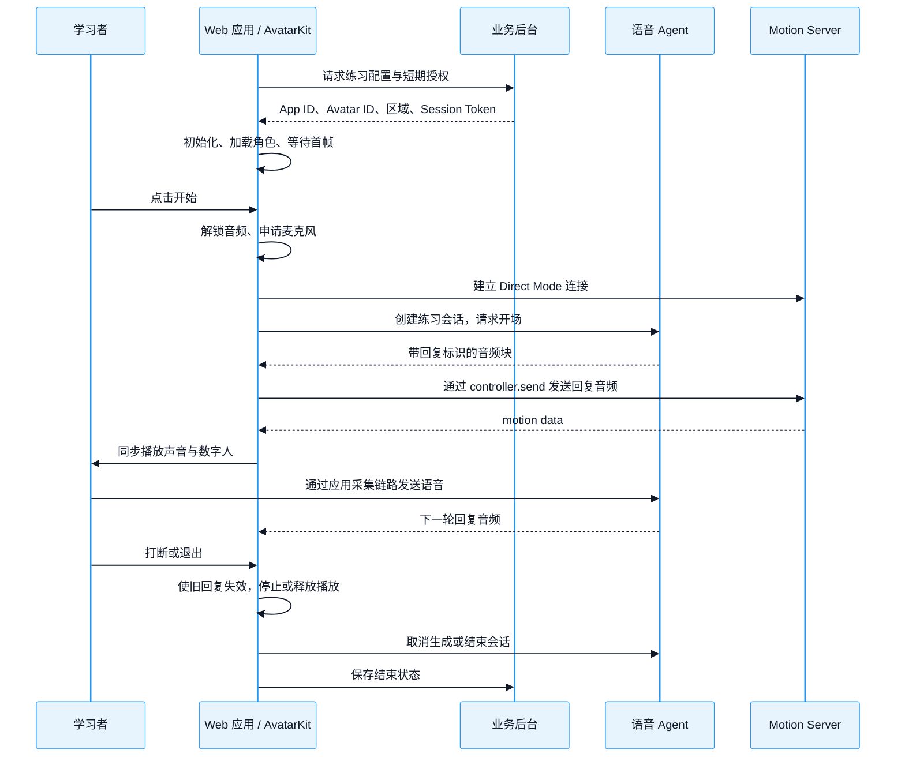

本文说明如何在 Web 语言学习产品中加入实时数字人，完成从进入练习、数字人开场、多轮对话，到打断和退出的完整接入。

参考组合为 **Public Avatar + AvatarKit Web SDK + Direct Mode**。语音 Agent 负责理解学习者并生成回复，Spatius 负责将回复音频转化为可见的数字人表现。已有 Agent 的产品可以直接接入；尚未构建 Agent 时，可以先使用参考工程提供的语音对话服务。

以下用英语口语练习说明实现过程。咖啡店员的台词只是示例，替换角色与任务内容后，同一套接入逻辑也可用于故事角色对话和职场语言演练。

## 前提条件

开始前准备以下内容：

- 在 Spatius Studio 创建应用，取得 App ID、API Key，并确认应用区域。
- 从公共形象库选择 Avatar，取得 Avatar ID。
- 准备可提供回复音频的语音 Agent，或使用本文后半部分的参考工程。
- 准备业务后台签发短期 Session Token。API Key 只保存在后台。
- Web 页面通过 HTTPS 或 localhost 运行，以使用麦克风；页面为 Avatar 提供具有实际宽高的容器。

本方案采用 16 kHz、单声道、16 位有符号小端 PCM 作为应用向 AvatarKit 提交的音频格式。这是参考实现选择的格式，不代表 SDK 只支持这一种采样率。

## 实现架构与时序

### 数据如何流动

学习者音频送入 Agent；Agent 的回复音频送入浏览器中的 AvatarKit。Direct Mode 下，AvatarKit 与 Motion Server 建立连接，发送回复音频、接收 motion data，在本地同步呈现数字人并播放声音。

| 位置 | 负责的工作 |
| --- | --- |
| 学习应用前端 | 麦克风、练习界面、AvatarKit、回复音频接收与播放控制 |
| 业务后台 | 用户鉴权、练习会话、Session Token、任务上下文与记录 |
| 语音 Agent | 语音理解、对话决策和回复音频生成 |
| Spatius Motion Server | 将回复音频转化为 motion data |

数字人回复统一由 AvatarKit 播放，关闭原有 Agent 播放器对同一段回复的播放，避免双重声音。麦克风音频用于 Agent 输入，不能作为数字人回复发送。

### 一次练习的推荐时序

<div style={{ background: '#ffffff', borderRadius: 12, padding: 16 }}>



</div>

图中的练习接口、Agent 会话、回复标识和取消消息由应用实现，不是 Spatius 的接口。后台也可以代理浏览器与 Agent 之间的音频传输，AvatarKit 的接入边界保持不变。

## 实现过程

### 1. 由后台下发配置和短期授权

**场景要求：** 同一产品可能有多个任务与角色，前端需要取得本次使用的 Avatar 和连接授权，同时不暴露 API Key。

建议业务后台提供一个经过用户鉴权的练习准备接口，返回如下结构。接口名称和练习字段可以按业务调整：

```json
{
  "practiceId": "practice-unique-id",
  "appId": "your-app-id",
  "avatarId": "your-public-avatar-id",
  "region": "us-west",
  "sessionToken": "short-lived-session-token",
  "expiresAt": 1800000000
}
```

`practiceId` 用来关联练习记录；`expiresAt` 是应用返回的到期时间示意。App ID、Avatar ID 和区域由后台配置决定，Token 必须由对应应用的 API Key 签发。

后台签发 Token 时，请求对应区域 Console API 的 `POST /v1/console/session-tokens`，在 `X-API-Key` 请求头传入 API Key，在 JSON 请求体中传入以秒为单位的 `expireAt`。接口返回 `sessionToken`。

例如，下面的 Node.js 服务端函数使用默认区域，为一次连接申请十分钟有效期的 Token：

```typescript
export async function issueSessionToken(apiKey: string) {
  const expireAt = Math.floor(Date.now() / 1000) + 10 * 60;
  const response = await fetch(
    'https://console.us-west.spatius.ai/v1/console/session-tokens',
    {
      method: 'POST',
      headers: {
        'Content-Type': 'application/json',
        'X-API-Key': apiKey,
      },
      body: JSON.stringify({ expireAt }),
    },
  );
  if (!response.ok) throw new Error('Session Token issuance failed');
  const data = await response.json();
  if (typeof data.sessionToken !== 'string') {
    throw new Error('Missing Session Token');
  }
  return { sessionToken: data.sessionToken, expiresAt: expireAt };
}
```

该函数仅展示平台请求；用户鉴权、限流和应用权限检查由业务接口补充。其他区域应使用对应 Console API 地址。

**异常处理：** Token 到期后不能用于新建连接，已建立的连接不会仅因 Token 到期而失效。如果用户长时间停留后才开始，或断线后准备重建连接，应重新取得有效授权。

### 2. 预加载 Avatar，等待首帧后开放开始入口

**场景要求：** 学习者进入练习时就能看到角色，但在角色未就绪时不开始对话。

安装 Web SDK：

```bash
npm install @spatius/avatarkit
```

Vite 项目使用官方插件提供 SDK 资源；已有 React 插件等配置继续保留：

```typescript
import { defineConfig } from 'vite';
import { avatarkitVitePlugin } from '@spatius/avatarkit/vite';

export default defineConfig({
  plugins: [avatarkitVitePlugin()],
});
```

以下函数完成角色准备。页面需提前创建具有实际宽高的容器，等待函数完成后再启用“开始练习”：

```typescript
import {
  AvatarSDK,
  AvatarManager,
  AvatarView,
  DrivingServiceMode,
} from '@spatius/avatarkit';

type AvatarConfig = {
  appId: string;
  avatarId: string;
  region: string;
  sessionToken: string;
};

export async function prepareAvatar(
  config: AvatarConfig,
  container: HTMLElement,
): Promise<AvatarView> {
  // 同一应用启动时初始化；不要在每轮回复中重复初始化。
  await AvatarSDK.initialize(config.appId, {
    region: config.region,
    drivingServiceMode: DrivingServiceMode.direct,
  });
  AvatarSDK.setSessionToken(config.sessionToken);
  const avatar = await AvatarManager.shared.load(config.avatarId);
  const view = new AvatarView(avatar, container, {
    audioFormat: { sampleRate: 16000, channelCount: 1 },
  });

  try {
    await new Promise<void>((resolve, reject) => {
      const timer = setTimeout(
        () => reject(new Error('Avatar first frame timed out')),
        20000,
      );
      view.onFirstRendering = () => {
        clearTimeout(timer);
        resolve();
      };
    });
    return view;
  } catch (error) {
    view.dispose();
    throw error;
  }
}
```

这里的 20 秒是示例界面超时策略，不是 SDK 的性能承诺。下载资源与完成首帧是不同阶段，不能只依据下载完成就开放对话。

**异常处理：** 加载失败或首帧超时时，显示失败原因和重试入口，不继续创建 Agent 会话。页面在准备过程中退出时，应标记这次准备已取消；异步加载稍后返回的视图也要释放，不能挂到已经退出的页面上。

### 3. 从用户操作启动音频、麦克风和连接

**场景要求：** 浏览器允许播放声音，且数字人和 Agent 都准备好后才开始开场。

首帧就绪后，在“开始练习”按钮的点击处理函数中调用 `initializeAudioContext()`，再建立数字人连接。下面的函数展示开始阶段的 SDK 与浏览器调用，返回麦克风流供现有 Agent 采集模块使用：

```typescript
import { AvatarView } from '@spatius/avatarkit';

export async function connectFromClick(view: AvatarView) {
  let microphone: MediaStream | undefined;
  try {
    // 在按钮点击处理函数中直接调用本函数。
    await view.controller.initializeAudioContext();
    microphone = await navigator.mediaDevices.getUserMedia({
      audio: true,
    });
    await view.controller.start();
    return microphone;
  } catch (error) {
    microphone?.getTracks().forEach(track => track.stop());
    view.controller.close();
    throw error;
  }
}
```

麦克风流还需要由应用采集、编码并送入 Agent，本函数不包含该过程。连接期间禁用重复开始；当 Agent 输入输出链路也就绪后，再请求开场，避免开场音频到达时数字人尚未连接。

例如开场为“Hi! What can I get for you today?”。它通过 Agent 正常的回复音频链路播放，不另开一个 HTML 音频播放器。

**异常处理：** 麦克风未授权时提示授权或退出；数字人连接失败时停止麦克风采集。页面在启动过程中退出，应在每个异步阶段返回时检查取消标识，并释放该阶段刚创建的资源。

### 4. 用回复标识隔离音频，处理正常结束与打断

**场景要求：** 学习者可以打断数字人。打断之后，即使网络中还有旧音频到达，也不能再次播放。

建议为每次回复分配在当前练习内唯一的 `replyId`，在开始回复、音频块和结束消息中携带。不要在重试后重复使用旧标识。应用可以采用如下消息约定：

| 应用消息 | 内容 | 客户端操作 |
| --- | --- | --- |
| `reply_start` | `practiceId`、`replyId` | 接受新回复，清理旧播放 |
| `reply_audio` | 同一回复标识、PCM 音频 | 只向 AvatarKit 发送当前有效回复的音频 |
| `reply_end` | 同一回复标识 | 通知输入结束，允许已缓冲音频继续播放 |
| `cancel_reply` | 待取消的回复标识 | 通知 Agent 停止该回复 |

消息名称是参考业务协议，不是 SDK 事件。传输层需要保持一轮音频块的顺序，例如使用同一条有序 WebSocket；如果还有乱序来源，应先排序再交给播放器。

下面的适配器负责接收当前回复，并忽略已经失效或已经结束输入的音频：

```typescript
import type { AvatarController } from '@spatius/avatarkit';

export function createReplyBridge(controller: AvatarController) {
  let activeId: string | null = null;
  let inputEnded = false;
  let disposed = false;
  const seen = new Set<string>();

  return {
    begin(replyId: string) {
      if (disposed || seen.has(replyId)) return false;
      seen.add(replyId);
      // 新回复接管播放，包括上一回复仍未播完的缓冲。
      controller.interrupt();
      activeId = replyId;
      inputEnded = false;
      return true;
    },
    audio(replyId: string, pcm: ArrayBuffer) {
      if (disposed || replyId !== activeId || inputEnded) return;
      if (pcm.byteLength > 0) controller.send(pcm, false);
    },
    end(replyId: string) {
      if (disposed || replyId !== activeId || inputEnded) return;
      inputEnded = true;
      controller.send(new ArrayBuffer(0), true);
    },
    cancel() {
      const cancelledId = activeId;
      // 先使旧回复失效，再停止播放。
      activeId = null;
      inputEnded = true;
      controller.interrupt();
      return cancelledId;
    },
    dispose() {
      disposed = true;
      activeId = null;
      seen.clear();
      controller.interrupt();
    },
  };
}
```

应用仍需在协议入口判断 `reply_start` 是否属于当前练习、当前请求；只为仍有效的请求调用 `begin()`。不能让一个已取消请求的迟到开始消息重新激活播放。适配器中的 `seen` 仅防止旧标识再次使用，不能代替上层请求有效性判断。

**正常结束：** `send(..., true)` 表示当前回复的输入结束，不能立即关闭连接，否则可能截断缓冲中尚未播放的声音。

**打断：** 先调用 `cancel()`，再通过业务链路取消 Agent 生成。即使取消请求失败，客户端也已经拒绝旧回复的数据。Agent 自己检测到用户插话时，也必须把取消信号传到这个适配器。

**音频格式：** 上述 `ArrayBuffer` 只包含 PCM 样本，不包含 WAV 文件头。音频随生成及时提交，不人为按播放速度限速。改变输入格式前需要按 SDK 的格式切换要求处理连接，首版建议整次练习保持同一格式。

### 5. 根据真实事件呈现界面状态

**场景要求：** 学习者知道角色是否就绪、系统是否正在生成回复、何时正在播放，而不是所有等待都显示为“数字人说话中”。

| 事件来源 | 可用于界面的状态 | 注意点 |
| --- | --- | --- |
| 应用资源准备与 `onFirstRendering` | 加载中、角色就绪 | 首帧前不开放开始 |
| `onConnectionState` | 连接中、已连接、连接失败 | 已连接不表示 Agent 也就绪 |
| Agent 请求与回复事件 | 正在处理、回复生成结束 | 生成结束不表示播放结束 |
| `onConversationState` | 正在播放、暂停、空闲 | 不把空闲直接解释为任务完成 |
| 应用麦克风与输入模块 | 麦克风已开启、静音 | SDK 的空闲状态不能代表正在识别用户 |
| `onError` | 错误提示与恢复入口 | 关联到具体练习排查 |

回调可以在创建视图后统一注册：

```typescript
import type { AvatarView } from '@spatius/avatarkit';

export function observeAvatar(
  view: AvatarView,
  update: (event: string, value: string) => void,
) {
  view.controller.onConnectionState = state => {
    update('connection', state);
  };
  view.controller.onConversationState = state => {
    update('playback', state);
  };
  view.controller.onError = error => {
    update('error', error.message);
  };
}
```

`update` 是应用自己的界面事件处理函数。统一在一处注册回调，避免多个组件直接赋值、互相覆盖。断线时立即让当前请求失效并停止送入音频；恢复连接后重新建立明确的练习状态，不直接重播未知进度的半段回复。

### 6. 结束练习并释放资源

**场景要求：** 用户退出、切换课程或页面卸载后，麦克风和计费连接不继续占用；重复退出不会再次创建或释放错误的会话。

结束顺序建议为：阻止新操作 → 使请求与回复失效 → 停止麦克风 → 关闭客户端连接和视图 → 通知后台结束 Agent 会话并保存结果。

以下为应用层清理函数。`invalidateRequests`、`stopAgent` 和 `saveResult` 都由业务实现：

```typescript
import type { AvatarView } from '@spatius/avatarkit';

type PracticeResources = {
  view: AvatarView;
  microphone: MediaStream;
  invalidateRequests: () => void;
  disposeReplies: () => void;
  stopAgent: () => Promise<void>;
  saveResult: () => Promise<void>;
};

export function createPracticeCleanup(resources: PracticeResources) {
  let finished = false;
  return async () => {
    if (finished) return;
    finished = true;
    resources.invalidateRequests();
    resources.disposeReplies();
    resources.microphone.getTracks().forEach(track => track.stop());
    resources.view.controller.close();
    resources.view.dispose();
    return Promise.allSettled([
      resources.stopAgent(),
      resources.saveResult(),
    ]);
  };
}
```

此示例适用于资源已创建完成的练习。准备或启动失败时，也要释放当时已经获得的部分资源。应用的音频采集处理器、Agent WebSocket、定时器和页面事件监听器同样需要停止。

后台结束请求失败不能阻止本地释放；应记录失败并补偿处理。关闭标签页时请求不一定能送达，因此服务端还需要会话过期或心跳超时回收，不能只依赖浏览器通知。

如果是正常完成任务并播放最后一句反馈，应同时确认该回复输入已结束、确实开始过播放且随后进入空闲，再执行结束；无音频、出错或超时也要有独立退出路径，不能只等待一个空闲回调。

## 将接入逻辑用于语言练习

数字人链路稳定后，将本次任务配置传给 Agent。例如咖啡练习可配置“收集饮品、杯型、打包方式，每次追问一项，必要时给出一句示例，再请学习者确认”。

应用保存任务进度，Agent 提供对应的对话行为。Avatar ID、声音与任务指令分开设置，便于替换人物和练习内容。Spatius 的连接与播放状态不承担教学评价；任务完成、纠错和评测由学习应用与相应能力模块实现。

| 场景 | 数字人接入保持不变 | 需要传给 Agent / 应用的内容 |
| --- | --- | --- |
| 口语情境练习 | 加载、回复音频、打断、退出 | 目标任务、角色规则和完成条件 |
| 故事后与人物对话 | 同一角色的实时呈现与音频链路 | 故事上下文、人物设定与对话范围 |
| 企业语言培训 | 多轮交流和状态协调 | 岗位情境、专业词汇和反馈规则 |

已有语音 Agent 时，优先完成回复音频适配、播放权转移、取消信号和会话生命周期对接。新产品则可以先用下述参考工程补齐 Agent，验证同一套数字人接入流程。

## 跑通参考工程

官方集成示例提供固定音频和实时对话两种演示，可以验证 SDK 接入。本文的回复标识适配器和业务接口是进一步集成时的设计示例，并非参考仓库中已经逐项实现的完整语言学习应用。

### 启动服务端和 Web 客户端

准备 Node.js、pnpm、Python 和 uv：

```bash
git clone https://github.com/spatius-ai/spatius-integration-demo.git
cd spatius-integration-demo/direct-mode/servers/python
cp .env.example .env
```

在服务端 `.env` 配置：

```dotenv
SPATIUS_APP_ID=your_app_id
SPATIUS_API_KEY=your_api_key
SPATIUS_REGION=us-west
SPATIUS_AVATAR_ID=your_public_avatar_id
```

也可将 `SPATIUS_AVATAR_ID` 留空使用示例默认公共形象。

```bash
uv sync
uv run app.py
```

另开终端，从仓库根目录执行：

```bash
cd direct-mode/clients/web/reference/react
pnpm install
pnpm dev
```

打开 `http://localhost:5173`，先选择固定音频演示，确认角色加载、声音与口型同步、正常结束和打断可用。这一步仅需 Spatius 配置，不需要语音 Agent 凭证。

### 接入实时对话

已有 Agent 时，使用其输出音频替换固定音频源。使用工程自带语音 Agent 时，在服务端补充以下配置后重启：

```dotenv
LIVEKIT_URL=wss://your-project.livekit.cloud
LIVEKIT_API_KEY=your_livekit_api_key
LIVEKIT_API_SECRET=your_livekit_api_secret
```

选择实时对话演示并允许麦克风。该工程使用 LiveKit Inference 运行语音 Agent，没有建立 LiveKit 房间；客户端通过应用 WebSocket 收发音频，数字人仍使用 Direct Mode。任务指令与声音通过工程的 Agent 配置调整。

<Note>
参考工程的后台未对调用方做身份验证，只用于本地开发。公开部署前需要增加用户鉴权、Token 签发限制及用量控制。
</Note>

## 联调验收与常见问题

| 验证操作 | 应观察到的结果 | 优先排查位置 |
| --- | --- | --- |
| 首次进入、重复进入 | 首帧后才可开始，无重复视图 | 容器尺寸、资源加载、卸载清理 |
| 点击开始并等待开场 | 开场完整，声音只出现一次 | 音频解锁、连接顺序、原播放器 |
| 连续进行两轮交流 | 音频顺序正确，旧回复不混入 | 回复标识、消息顺序、输入结束信号 |
| 打断后模拟旧音频迟到 | 旧数据被忽略，新回复可播放 | 请求有效性、回复适配器 |
| Agent 先生成完、音频仍在播放 | 不提前结束或关闭连接 | 生成结束与播放结束是否混淆 |
| 断网或拒绝麦克风 | 提示可恢复操作，不保留旧采集 | 错误回调、失败路径清理 |
| 退出后重试 | 旧请求失效，旧连接与麦克风释放 | 清理函数、后台会话回收 |

**有声音但口型异常或播放速度不对：** 检查交给 AvatarKit 的是否为 Agent 回复 PCM，采样率、声道和位深是否匹配，是否误传文件头或压缩数据。

**角色已显示但无法出声：** 首帧只代表渲染就绪，继续检查音频上下文是否通过用户操作初始化、controller 是否已连接、回复是否已送入。

**打断后又出现上一句：** 检查是否只调用了 `interrupt()`，却没有取消生成或过滤迟到的开始消息和音频块。

**第一次正常，第二次异常：** 检查是否复用了已释放的 view、过期 Token、旧请求标识或已经结束的麦克风流。重新开始时建立新练习状态。

验收时记录练习标识、回复标识、设备、浏览器、网络、音频格式，以及首帧、连接、首段回复、播放和退出等关键事件时间。不要在客户端日志记录 API Key 或完整 Session Token。

## 开发参考资料

| 资料 | 用途 |
| --- | --- |
| [React 参考客户端](https://github.com/spatius-ai/spatius-integration-demo/tree/main/direct-mode/clients/web/reference/react) | 查看可运行的音频接入与角色展示 |
| [Python 参考服务](https://github.com/spatius-ai/spatius-integration-demo/tree/main/direct-mode/servers/python) | 配置、Token 与示例 Agent |
| [Web SDK 参考](/sdk-reference/web-sdk/reference) | 完整类型、参数与回调定义 |
| [Direct Mode 接入](/direct-mode/client) | 接入要求与配置 |
| [Session Token API](/api-reference/api-reference) | Token 请求与区域 API |
